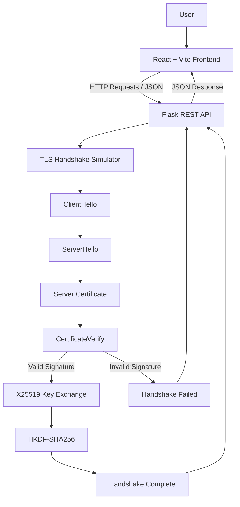

# CryptLink — Secure Communication Simulator

CryptLink is an educational web application that simulates important concepts behind a TLS-style client–server handshake. It combines a Flask backend for cryptographic operations with a React frontend for visualizing handshake events, security status, and message details.

> **Note:** CryptLink is an educational simulator, not a production TLS implementation. It does not implement the complete TLS 1.3 protocol or a fully authenticated TLS connection.

## 1. Features

- Interactive React dashboard for visualizing handshake events.
- Flask REST API for managing handshake simulations.
- ClientHello and ServerHello message simulation.
- Temporary self-signed certificate generation.
- RSA-PSS signature generation and verification.
- X25519 ephemeral key exchange.
- Shared-secret comparison between client and server.
- HKDF-SHA256 session-key derivation.
- Tampered-signature attack simulation.
- Real-time status display and event details.
- Reset functionality for restarting simulations.

## 2. System Architecture

CryptLink follows a frontend–backend architecture.



### Architecture Components

**1. React Frontend**
- Provides the user interface.
- Starts and resets handshake simulations.
- Displays handshake events and status.
- Shows event details in JSON format.
- Provides a signature-attack simulation control.

**2. Flask Backend**
- Exposes REST API endpoints.
- Receives requests from the frontend.
- Executes the handshake simulation.
- Returns event information and results as JSON.

**3. TLS Handshake Simulator**
- Generates random values and ephemeral keys.
- Creates a temporary self-signed certificate.
- Signs and verifies simulated handshake data.
- Computes shared secrets and derives session keys.
- Detects deliberately tampered signatures.

**4. Cryptographic Library**
The Python `cryptography` library provides RSA, RSA-PSS, X25519, SHA-256, certificate, and HKDF functionality.

## 3. Handshake Workflow

### Successful Handshake

1. **ClientHello:** The client proposes simulated protocol and cryptographic parameters.
2. **ServerHello:** The server selects parameters and provides its random value and ephemeral public key.
3. **ServerCertificate:** The server generates and presents a temporary self-signed certificate.
4. **CertificateVerify:** The simulator verifies a digital signature to demonstrate proof of possession of the certificate's private key.
5. **KeyExchange:** The client and server independently calculate matching shared secrets using X25519.
6. **HandshakeComplete:** HKDF-SHA256 derives session-key material, and the simulator confirms the derived keys match.

**Expected result:** `SUCCESS`

### Tampered Signature Attack

The simulator can deliberately modify the generated signature before verification.

1. The handshake begins normally.
2. The certificate is generated.
3. The signature is modified.
4. Signature verification fails.
5. The handshake terminates and records a security failure.

**Expected result:** `FAILED`

The failed handshake should contain a `CertificateVerify` event with `signature_valid: false`, followed by a `HandshakeFailed` event.

## 4. Technology Stack

| Layer | Technologies |
|---|---|
| Frontend | React, Vite, JavaScript, CSS |
| UI Icons | Lucide React |
| Backend | Python, Flask |
| API Communication | HTTP, JSON |
| Cross-Origin Support | Flask-CORS |
| Cryptography | Python cryptography library |
| Key Exchange | X25519 |
| Digital Signature | RSA-PSS with SHA-256 |
| Key Derivation | HKDF-SHA256 |
| Version Control | Git, GitHub |

## 5. Project Structure

```text
CryptLink/
├── backend/
│   ├── app.py
│   ├── tls_simulator.py
│   └── requirements.txt
├── frontend/
│   ├── src/
│   │   ├── App.jsx
│   │   ├── App.css
│   │   └── index.css
│   ├── package.json
│   └── ...
└── README.md
```

## 6. Prerequisites

Install the following:

- Python 3.10 or newer recommended.
- Node.js and npm.
- Git (optional, for version control).

## 7. Installation and Setup

### Backend Setup

Open a terminal in the project root:

```bash
cd backend
python -m venv .venv
```

Activate the virtual environment.

**Windows Git Bash:**

```bash
source .venv/Scripts/activate
```

**Windows PowerShell:**

```powershell
.\.venv\Scripts\Activate.ps1
```

**macOS/Linux:**

```bash
source .venv/bin/activate
```

Install dependencies:

```bash
pip install -r requirements.txt
```

The `backend/requirements.txt` file should contain:

```text
Flask
Flask-Cors
cryptography
```

### Frontend Setup

Open a second terminal from the project root:

```bash
cd frontend
npm install
```

## 8. Running the Application

The backend and frontend run in separate terminals.

### Start the Backend

From the `backend` directory, activate the virtual environment if needed and run:

```bash
python app.py
```

Expected backend address:

`http://127.0.0.1:5000`

### Start the Frontend

From the `frontend` directory, run:

```bash
npm run dev
```

Open the local URL printed by Vite, usually:

`http://localhost:5173`

The frontend communicates with the Flask API at:

`http://127.0.0.1:5000/api`

Flask-CORS must allow the frontend origin.

## 9. API Endpoints

The following endpoints are expected in the project. Check `backend/app.py` to confirm the routes enabled in your current version.

| Method | Endpoint | Purpose |
|---|---|---|
| GET | `/` | Basic backend information, if enabled |
| GET | `/api/health` | Health check |
| POST | `/api/handshake/start` | Start a handshake simulation |
| GET | `/api/handshake/status` | Retrieve status, if enabled |
| POST | `/api/handshake/reset` | Reset the simulator |

### Test a Normal Handshake

```bash
curl -X POST http://127.0.0.1:5000/api/handshake/start
```

Expected result: `SUCCESS`, with six events for the normal handshake.

### Test Signature Tampering

Run in Git Bash, macOS, or Linux:

```bash
curl -X POST http://127.0.0.1:5000/api/handshake/start \
  -H "Content-Type: application/json" \
  -d '{"simulate_failure":"tampered_signature"}'
```

Expected result: `FAILED`, with a failed `CertificateVerify` event and a `HandshakeFailed` event.

### Test the Health Endpoint

```bash
curl http://127.0.0.1:5000/api/health
```

This command works if the health endpoint is enabled.

## 10. Testing Checklist

Before demonstrating or submitting the project, verify the following:

- [ ] Flask starts without errors.
- [ ] React starts and loads successfully.
- [ ] The normal handshake returns `SUCCESS`.
- [ ] All six normal handshake events appear.
- [ ] The signature-attack simulation returns `FAILED`.
- [ ] The failed signature is displayed as `signature_valid: false`.
- [ ] The `HandshakeFailed` event is visible.
- [ ] Reset clears the event timeline and restores the initial status.
- [ ] No unexpected errors appear in the browser console or backend terminal.

## 11. Troubleshooting

### Backend Connection Error

1. Confirm Flask is running.
2. Check that the frontend API address is `http://127.0.0.1:5000/api`.
3. Check the Flask-CORS configuration.
4. Verify that the requested endpoint exists.

### Attack Simulation Returns SUCCESS

Confirm that `app.py` reads the JSON request body and passes the failure option to the simulator:

```python
data = request.get_json(silent=True) or {}
simulate_failure = data.get("simulate_failure")
result = simulator.run(simulate_failure=simulate_failure)
```

The simulator must support the `tampered_signature` option.

### Frontend Button Error

- Check the browser developer console.
- Confirm the handler is declared inside the React `App()` component and outside other handlers.
- Ensure the button calls the correct handler.
- Confirm Flask is running.

### Python Dependency Error

Activate the correct virtual environment and run:

```bash
pip install -r requirements.txt
```

## 12. Security and Limitations

- The generated certificate is self-signed. A valid self-signature does not establish certificate trust.
- The simulated `CertificateVerify` operation is not the complete TLS 1.3 transcript-signing procedure.
- The X25519 and HKDF operations demonstrate key exchange and key derivation concepts, but do not implement the complete TLS 1.3 key schedule.
- The project does not implement the complete TLS record protocol or a production-ready authenticated TLS connection.
- Session-key fingerprints are shortened hashes for demonstration. Actual session keys should not be displayed or logged.
- This application is intended for local education and demonstration, not for securing real communications.

## 13. Future Improvements

- Add automated tests for successful and failed handshakes.
- Improve API request validation and error handling.
- Add a step-by-step animated timeline.
- Add screenshots and a project demonstration video.
- Introduce additional educational security scenarios.
- Improve the certificate-trust demonstration.

## 14. Project Information

**Project Name:** CryptLink — Secure Communication Simulator

**Repository:** https://github.com/ApoorvaPoojary8/CryptLink

**Purpose:** To demonstrate core cryptographic concepts involved in secure client–server handshake simulations through an interactive web application.
