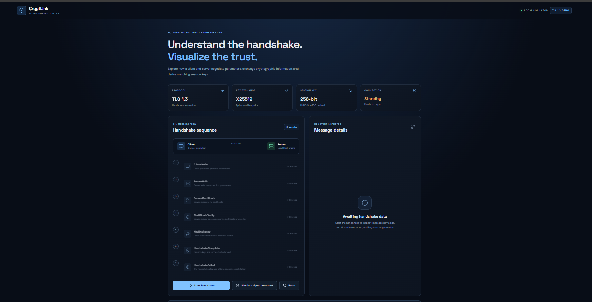
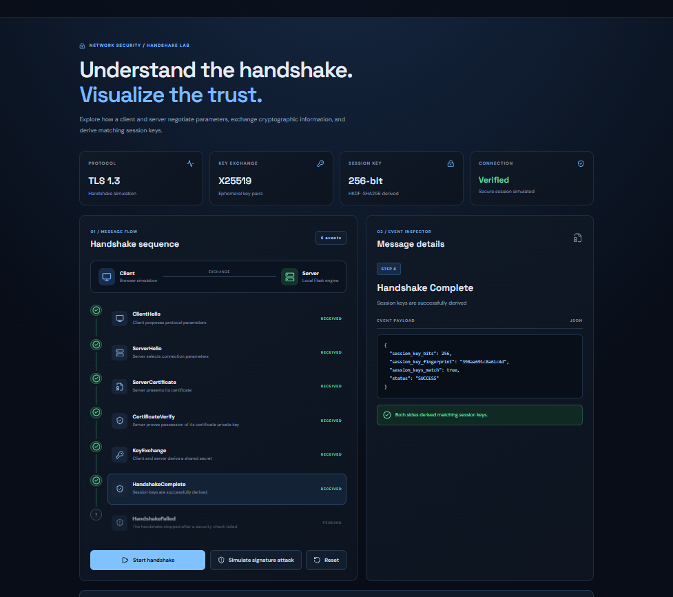
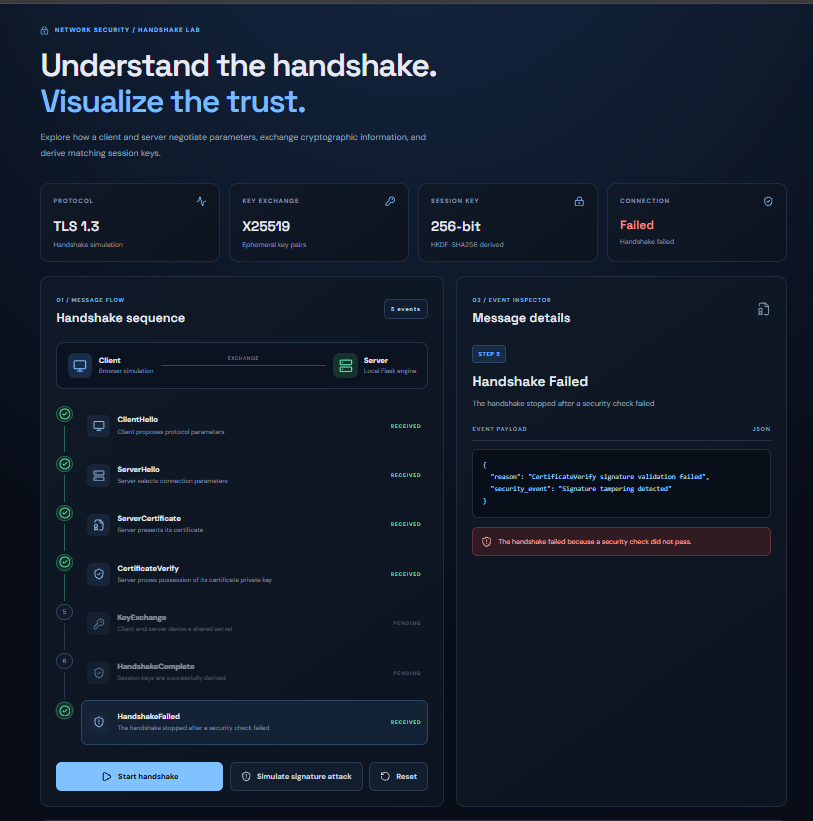

# CryptLink — Secure Communication Web Application

CryptLink is a web application that simulates key steps of a TLS-style client–server handshake. It combines a React frontend with a Python Flask backend to demonstrate handshake message exchange, certificate generation, digital signature verification, cryptographic key exchange, and session-key derivation.

The application also includes a signature-tampering scenario to demonstrate how an invalid digital signature causes the handshake to fail.

## 1. Features

- Interactive web dashboard for visualizing handshake events.
- ClientHello and ServerHello message simulation.
- Temporary self-signed server certificate generation.
- RSA-PSS digital signature generation and verification.
- X25519 ephemeral key exchange.
- Shared-secret comparison between client and server.
- HKDF-SHA256 session-key derivation.
- Signature-tampering attack simulation.
- Handshake success and failure status display.
- Detailed JSON event inspection.
- Reset functionality to restart the handshake process.

## 2. System Architecture

CryptLink follows a frontend–backend architecture in which the React frontend communicates with the Flask REST API using HTTP requests and JSON responses.


### Architecture Components

**1. React Frontend**

- Provides the application interface.
- Initiates and resets handshake simulations.
- Displays the handshake timeline and connection status.
- Shows detailed event information in JSON format.
- Provides controls for testing signature tampering.

**2. Flask Backend**

- Exposes REST API endpoints.
- Receives requests from the frontend.
- Executes the handshake process.
- Returns event information and results as JSON.

**3. TLS Handshake Engine**

- Generates random values and ephemeral keys.
- Creates a temporary self-signed certificate.
- Generates and verifies digital signatures.
- Computes shared secrets and derives session keys.
- Detects deliberately tampered signatures.

**4. Cryptographic Library**

The Python `cryptography` library provides the cryptographic operations used for RSA, RSA-PSS, X25519, SHA-256, certificate handling, and HKDF.

## 3. Handshake Workflow

### Successful Handshake

1. **ClientHello:** The client proposes simulated protocol and cryptographic parameters.
2. **ServerHello:** The server selects parameters and provides its random value and ephemeral public key.
3. **ServerCertificate:** The server generates and presents a temporary self-signed certificate.
4. **CertificateVerify:** The application verifies a digital signature using the certificate's public key.
5. **KeyExchange:** The client and server independently calculate matching shared secrets using X25519.
6. **HandshakeComplete:** HKDF-SHA256 derives session-key material, and the application checks that the derived keys match.

**Expected result:** `SUCCESS`

### Signature-Tampering Scenario

CryptLink includes a scenario that deliberately modifies a generated signature before verification.

1. The handshake begins normally.
2. The server certificate is generated.
3. The signature is modified.
4. Signature verification fails.
5. The handshake terminates and records a security failure.

**Expected result:** `FAILED`

The response includes a `CertificateVerify` event with `signature_valid: false`, followed by a `HandshakeFailed` event.

## 4. Technology Stack

| Layer | Technologies |
|---|---|
| Frontend | React, Vite, JavaScript, CSS |
| UI Icons | Lucide React |
| Backend | Python, Flask |
| API Communication | HTTP, JSON |
| Cross-Origin Support | Flask-CORS |
| Cryptographic Operations | Python cryptography library |
| Key Exchange | X25519 |
| Digital Signatures | RSA-PSS with SHA-256 |
| Key Derivation | HKDF-SHA256 |
| Version Control | Git, GitHub |

## 5. Project Structure

```text
CryptLink/
├── backend/
│   ├── app.py
│   ├── tls_simulator.py
│   └── requirements.txt
├── frontend/
│   ├── src/
│   │   ├── App.jsx
│   │   ├── App.css
│   │   └── index.css
│   ├── package.json
│   └── ...
└── README.md
```

## 6. Prerequisites

Install the following software:

- Python 3.10 or newer recommended.
- Node.js and npm.
- Git for version control.

## 7. Installation and Setup

### Backend Setup

Open a terminal in the project root:

```bash
cd backend
python -m venv .venv
```

Activate the virtual environment.

**Windows Git Bash:**

```bash
source .venv/Scripts/activate
```

**Windows PowerShell:**

```powershell
.\.venv\Scripts\Activate.ps1
```

**macOS/Linux:**

```bash
source .venv/bin/activate
```

Install the backend dependencies:

```bash
pip install -r requirements.txt
```

The `backend/requirements.txt` file should contain:

```text
Flask
Flask-Cors
cryptography
```

### Frontend Setup

Open a second terminal from the project root:

```bash
cd frontend
npm install
```

## 8. Running the Application

The frontend and backend run in separate terminals.

### Start the Backend

From the `backend` directory, activate the virtual environment if necessary and run:

```bash
python app.py
```

The backend is expected to be available at:

`http://127.0.0.1:5000`

### Start the Frontend

From the `frontend` directory, run:

```bash
npm run dev
```

Open the local URL displayed by Vite, usually:

`http://localhost:5173`

The frontend communicates with the Flask API at:

`http://127.0.0.1:5000/api`

Flask-CORS must allow the frontend origin.

## 9. API Endpoints

The application is designed around the following endpoints. Confirm their availability in `backend/app.py`.

| Method | Endpoint | Purpose |
|---|---|---|
| GET | `/` | Basic backend information, if enabled |
| GET | `/api/health` | Backend health check |
| POST | `/api/handshake/start` | Start a handshake or signature-tampering scenario |
| GET | `/api/handshake/status` | Retrieve handshake status, if enabled |
| POST | `/api/handshake/reset` | Reset the handshake state |

### Start a Normal Handshake

```bash
curl -X POST http://127.0.0.1:5000/api/handshake/start
```

Expected result: `SUCCESS`, with six events in the normal handshake.

### Simulate Signature Tampering

Run in Git Bash, macOS, or Linux:

```bash
curl -X POST http://127.0.0.1:5000/api/handshake/start \
  -H "Content-Type: application/json" \
  -d '{"simulate_failure":"tampered_signature"}'
```

Expected result: `FAILED`, with a failed `CertificateVerify` event and a `HandshakeFailed` event.

### Check Backend Health

```bash
curl http://127.0.0.1:5000/api/health
```

This command works if the health endpoint is enabled.

## 10. Testing Checklist

Before demonstrating the application, verify the following:

- [ ] Flask starts without errors.
- [ ] React starts and loads successfully.
- [ ] Start Handshake returns `SUCCESS`.
- [ ] All six normal handshake events appear.
- [ ] Simulate Signature Attack returns `FAILED`.
- [ ] The tampered signature is displayed as `signature_valid: false`.
- [ ] The `HandshakeFailed` event is visible.
- [ ] Reset clears the timeline and restores the initial status.
- [ ] No unexpected errors appear in the browser console or backend terminal.

## 11. Troubleshooting

### Backend Connection Error

1. Confirm that Flask is running.
2. Check that the frontend API address is `http://127.0.0.1:5000/api`.
3. Verify the Flask-CORS configuration.
4. Confirm that the requested endpoint exists.

### Signature-Tampering Scenario Returns SUCCESS

Check that the `/api/handshake/start` route reads the JSON request and passes the failure option to the simulator:

```python
data = request.get_json(silent=True) or {}
simulate_failure = data.get("simulate_failure")
result = simulator.run(simulate_failure=simulate_failure)
```

The simulator must support the `tampered_signature` option.

### Frontend Button Error

- Check the browser developer console.
- Ensure the event handler is declared inside the React `App()` component and outside other handlers.
- Confirm that the button calls the correct handler.
- Verify that the backend is running.

### Python Dependency Error

Activate the correct virtual environment and run:

```bash
pip install -r requirements.txt
```

## 12. Security Considerations and Limitations

- The generated certificate is self-signed. A valid self-signature does not establish certificate trust.
- The simulated `CertificateVerify` operation does not implement the complete TLS 1.3 transcript-signing procedure.
- X25519 and HKDF demonstrate key exchange and key derivation, but the complete TLS 1.3 key schedule is not implemented.
- The application does not implement the complete TLS record protocol or a production-ready authenticated TLS connection.
- Session-key fingerprints are shortened hashes for demonstration. Actual session keys should not be displayed or logged.


## Screenshots

### CryptLink Dashboard


### Successful TLS-Style Handshake


### Signature Tampering Detection



## 13. Project Information

**Project Name:** CryptLink — Secure Communication Web Application

**Repository:** https://github.com/ApoorvaPoojary8/CryptLink

**Purpose:** To provide a web-based interface for visualizing TLS-style handshake operations, cryptographic key exchange, digital signature verification, and signature-tampering detection.
